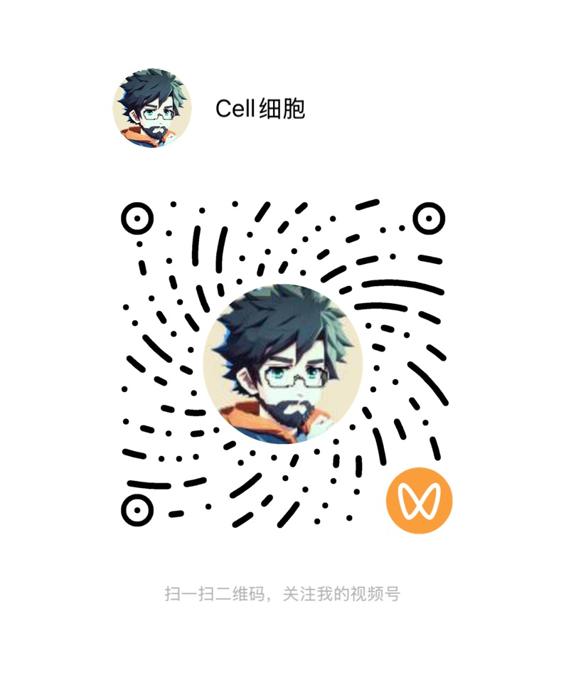
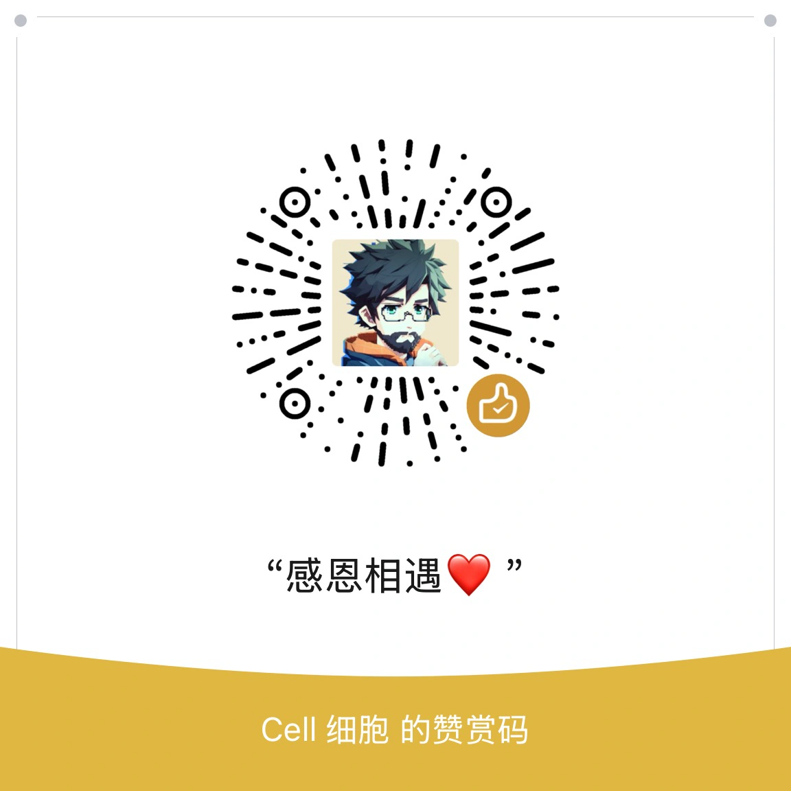

<!-- bip:project:start -->
# {{PROJECT_NAME}}

{{PROJECT_SUMMARY}}

这是一个用于开始 Vibe Coding 与 Build in Public 项目的 GitHub 模板。项目初始化后，这一区域替换为实际项目说明。

## 从模板开始

1. 在 GitHub 选择 **Use this template** 创建自己的仓库，再克隆到本地。
2. 对 AI 说：「用这个模板做一个 XX，先完成能运行的最小版本。」支持本仓库 Skill 的工具可调用 `$init-bip-project`。
3. AI 读取 [AGENTS.md](AGENTS.md)，填写 [项目规格](specs/VISION.md)，更新本区域与 [配置](template.config.json)。
4. 完成后运行 `python3 scripts/check_template.py --project`。没有 Python 3 时，按 AI 规则中的清单人工核对。

初始化后的 README 应写明用途、当前实现、安装与运行、验证方式、部署方式和已知限制；只写实际成立的内容。截图、技术栈和 BIP 开发记录按项目需要加入。

## 模板检查

无需安装依赖，使用 Python 3.10+：

```sh
python3 scripts/check_template.py
python3 -m unittest discover -s tests -v
```

默认检查允许尚未填写的模板。`--project` 用于完成初始化后检查残留占位符和项目配置。检查只读，不改文件，不访问网络，也不代替项目的运行测试。
<!-- bip:project:end -->

<!-- bip:creator:start -->
## 关于作者

你好，我是 **Cell 细胞**。我写代码，也写文章，把好奇心做成作品，探索更自主的工作与生活。

- [个人站 · cellinlab.com](https://cellinlab.com/)：作品、文章与联系入口。
- [造物矩阵](https://zaowujuzhen.com/about)：连接正在创造的人、作品与实践；公开创作记录、会员内容与交流是其中的一部分。
- [X · @cellinlab](https://x.com/cellinlab)：公开探索和开发进展。

扫码加我微信，备注 **GitHub** 就行。点击图片可查看原图。

<table>
  <tr>
    <td align="center" width="33%"><a href="public/wetouch/wechat.webp"></a><br>个人微信</td>
    <td align="center" width="33%"><a href="public/wetouch/wechat-channels.webp"></a><br>视频号</td>
    <td align="center" width="33%"><a href="public/wetouch/wechat-official.webp"></a><br>公众号 · Cell 细胞呀</td>
  </tr>
</table>

## 赞助

如果这些项目对你有帮助，也欢迎支持我的持续探索。

<table>
  <tr>
    <td align="center" width="50%"><br>支付宝</td>
    <td align="center" width="50%"><br>微信赞赏</td>
  </tr>
</table>
<!-- bip:creator:end -->

## License

[MIT](LICENSE)。使用模板请保留原许可证中的版权和许可声明。作者介绍、联系与赞助区是可配置内容，不是额外的授权条件。
