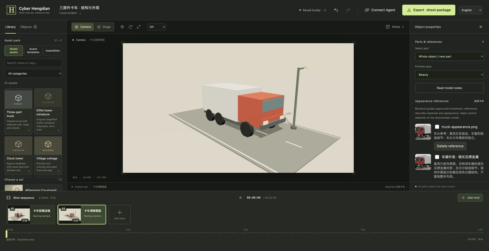
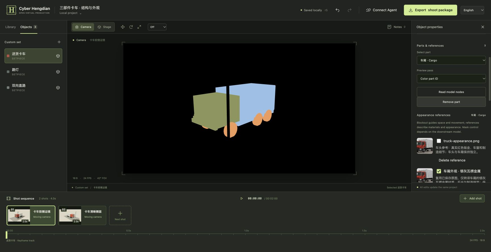

<!-- bip:project:start -->
# 赛博横店 · Cyber Hengdian

**搭一次片场，让人和 AI 接着拍。**

[English](README.en.md) · [快速开始](#快速开始) · [三部件卡车案例](examples/truck-parts/README.md) · [Agent 接入](docs/AGENTS.md) · [贡献指南](CONTRIBUTING.md)

面向视频创作者与 AI Agent 的开源虚拟片场基础设施。在浏览器中搭场景、调人物与镜头，把空间、动作、部件标记和外观参考保存为可继续编辑的工程，再导出给视频制作流程使用。



## 快速开始

需要 **Node.js 22.12+**。图片预览需要 Chrome / Chromium；视频导出还需要 FFmpeg。

```sh
npm install
npm run dev
```

打开 **http://127.0.0.1:4317**，选择场景并开始拍摄。界面支持简体中文与 English。

macOS 默认使用已安装的 Google Chrome。其他环境可运行 `npx playwright install chromium`，或用 `CHROME_PATH` 指定浏览器；用 `FFMPEG_PATH` 指定 FFmpeg。`PORT` 更改端口，`HENGDIAN_DATA` 更改工作空间目录。工程默认保存在被 Git 忽略的 `.hengdian/`，升级代码时保留该目录。

```sh
npm run build
npm start
```

## 从想法到拍摄包

1. **搭片场**：选完整场景，加入模型或组合，也可导入自包含 GLB。
2. **安排表演**：调整人物关节与姿势，把走位和姿态保存为镜头关键帧。
3. **调镜头**：选择摄影机配方，设置起止构图、跟拍目标和时间。
4. **标记部件与外观**：把车头、车厢、车轮等网格归入语义部件，绑定整体或部件的外观参考图。
5. **检查并导出**：播放预演，检查部件 ID 与黑白遮罩，导出工程、视频、控制通道和参考资产。



## 可以做什么

| 创作任务 | 已有能力 |
| --- | --- |
| 快速搭景 | 庭院、产品摄影棚、室外片场，以及乡村道路、都市街道、教室、医院、巴黎广场；原创程序化模型、4 个组合与 GLB 导入 |
| 调度人物 | 17 组关节、8 种姿势预设、行走/奔跑/招手/说话/待机；位置与姿态轨道独立编辑 |
| 安排摄影机 | 9 个镜头配方、自由布置与摄影机视角、稳定对象跟拍、时间批注 |
| 表达局部约束 | 语义部件标记、彩色 Part ID、逐部件黑白遮罩、整体与部件外观参考绑定；[使用说明](docs/PARTS.md) |
| 继续编辑 | 版本化原子操作、撤销/重做、冲突检测、落盘恢复；网页、CLI 与 MCP 共享同一份工程 |
| 交给其他工具 | 可编辑工程、引用资产、参考 MP4、关键帧、逐帧摄影机数据与校验清单；可选深度、对象 ID 与部件遮罩 |

部件遮罩表达画面中可见的边界，外观图表达材质、颜色和风格。下游工具是否接受这些输入、能否保持结构，需要分别验证。参考图与白模预演应共同交接，避免把预演造型和机械动作直接当作成片外观。

## 可复用案例

| 案例 | 适合验证什么 |
| --- | --- |
| [三部件卡车](examples/truck-parts/README.md) | 网格分组、遮挡、部件遮罩、外观参考与拍摄包恢复 |
| [教室人物](examples/actor-classroom/README.md) | 真实 Codex 建场、关节姿态轨道、画面检查与 720p 导出 |
| [庭院会面](docs/CODEX.md) | 从自然语言搭场景，调整镜头并导出拍摄包 |
| [香水广告与公路电影](examples/showcase/README.md) | 产品构图、双人走位、运镜与生成工具交接 |

以前的 [TapNow 实测](docs/showcase/TAPNOW.md) 记录了产品构图漂移、人物保留木偶造型和机械步态等问题。测试完成与导演意图满足分别记录，供后续创作继续改进。

## 用 Agent 导演

先启动本地服务，再由 Agent 宿主启动 stdio MCP：

```sh
npm run mcp
```

通过 `HENGDIAN_URL` 连接其他服务端口。配置见 [Agent 指南](docs/AGENTS.md)，导演流程见 [Skill](.agents/skills/direct-hengdian/SKILL.md)。Skill 组织读取、修改、预览与导出；工程及资源保存在独立开放格式中。

```sh
npm run cli -- --help
npm run cli -- status
npm run cli -- catalog
```

已有登录的 Codex CLI 可运行 `npm run codex:direct -- examples/codex-courtyard/01-stage.md`。这会调用真实模型并修改连接的工作空间；实验请使用独立目录。Codex 的实际验证范围见 [接入记录](docs/CODEX.md)。其他 MCP 宿主及 DeepSeek Harness 仍需各自实测。

## 扩展与贡献

添加模型、场景、镜头配方或案例都可以帮助下一位创作者。资源包仅包含数据，外部模型需准确记录来源与再分发许可。

- [资产库](docs/ASSET-LIBRARY.md)：模型单位、枢轴、组合与原创几何约定。
- [部件与参考](docs/PARTS.md)：分组、遮罩语义和参考资产交接。
- [工程格式](docs/FORMAT.md) · [架构](specs/ARCHITECTURE.md)：共享数据与确定性渲染。
- [贡献指南](CONTRIBUTING.md) · [国际化](docs/INTERNATIONALIZATION.md)：开发、验证与翻译。
- [扩展规划](specs/DIRECTOR-EXPANSION.md) · [导演台调研](docs/research/DIRECTOR-LANDSCAPE.md)：已实现能力与后续方向。

```sh
npm run check
npm run test:e2e
```

## 当前边界

当前为本地优先的早期工作台。视频生成由外部工具完成，尚无内置 TapNow 自动直连或公开云端协作。人物使用 FK 关节，尚无 IK、自动脚底锁定、手持约束或通用骨骼重定向；程序行走需要位置关键帧安排位移。摄影机路径采用起止点插值。

控制通道按不透明几何输出可见表面；深度为线性 8-bit，完整控制通道最多 720 帧。GLB 保留原单位与枢轴，默认使用首个动画。内置布景为预演精度，通过兼容运行时重建；拍摄包不包含它们的独立 GLB。详细格式见 [工程说明](docs/FORMAT.md)。

## 学习与交流

[**AI 影视短片制作｜从零到独立成片**](https://zaowujuzhen.com/r/RFAGZXABM)

专栏配有专属交流群，一起交流 AI 视频创作、镜头设计与赛博横店实践。

<a href="https://zaowujuzhen.com/r/RFAGZXABM"></a>

<!-- bip:project:end -->

<!-- bip:creator:start -->
## 关于作者

你好，我是 **Cell 细胞**。我写代码，也写文章，把好奇心做成作品，探索更自主的工作与生活。

- [个人站 · cellinlab.com](https://cellinlab.com/)：作品、文章与联系入口。
- [造物矩阵](https://zaowujuzhen.com/about)：连接正在创造的人、作品与实践；公开创作记录、会员内容与交流是其中的一部分。
- [X · @cellinlab](https://x.com/cellinlab)：公开探索和开发进展。

扫码加我微信，备注 **GitHub** 就行。点击图片可查看原图。

<table>
  <tr>
    <td align="center" width="33%"><a href="public/wetouch/wechat.webp"></a><br>个人微信</td>
    <td align="center" width="33%"><a href="public/wetouch/wechat-channels.webp"></a><br>视频号</td>
    <td align="center" width="33%"><a href="public/wetouch/wechat-official.webp"></a><br>公众号 · Cell 细胞呀</td>
  </tr>
</table>

## 赞助

如果这些项目对你有帮助，也欢迎支持我的持续探索。

<table>
  <tr>
    <td align="center" width="50%"><br>支付宝</td>
    <td align="center" width="50%"><br>微信赞赏</td>
  </tr>
</table>
<!-- bip:creator:end -->

## License

[MIT](LICENSE)。使用模板请保留原许可证中的版权和许可声明。作者介绍、联系与赞助区是可配置内容，不是额外的授权条件。
