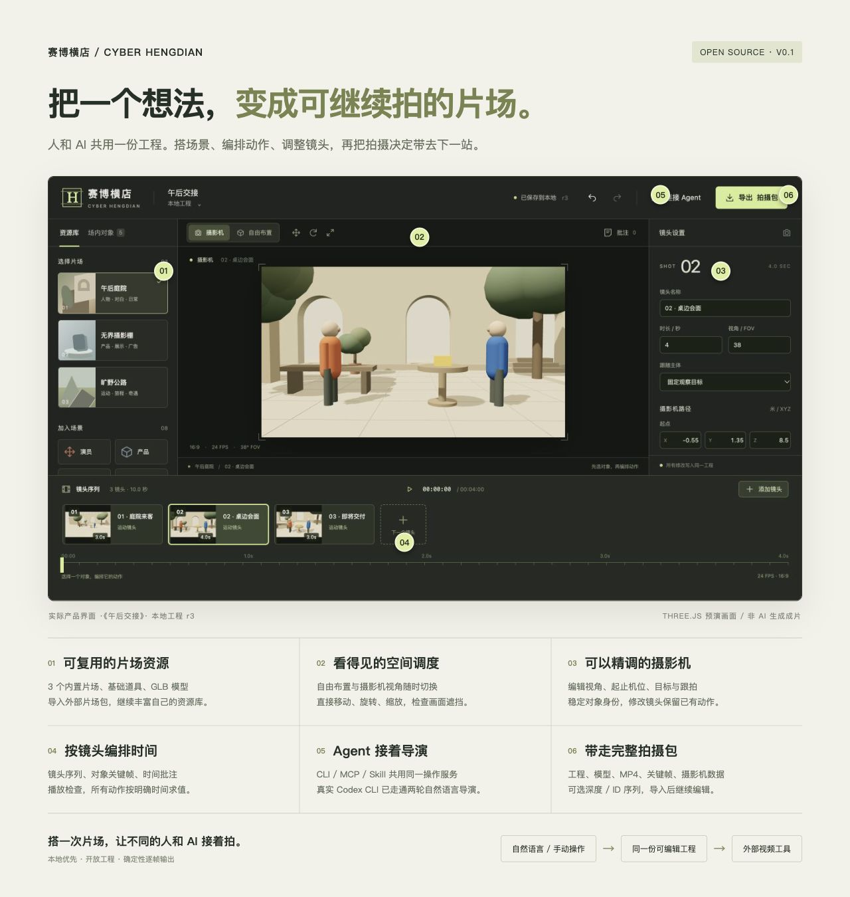
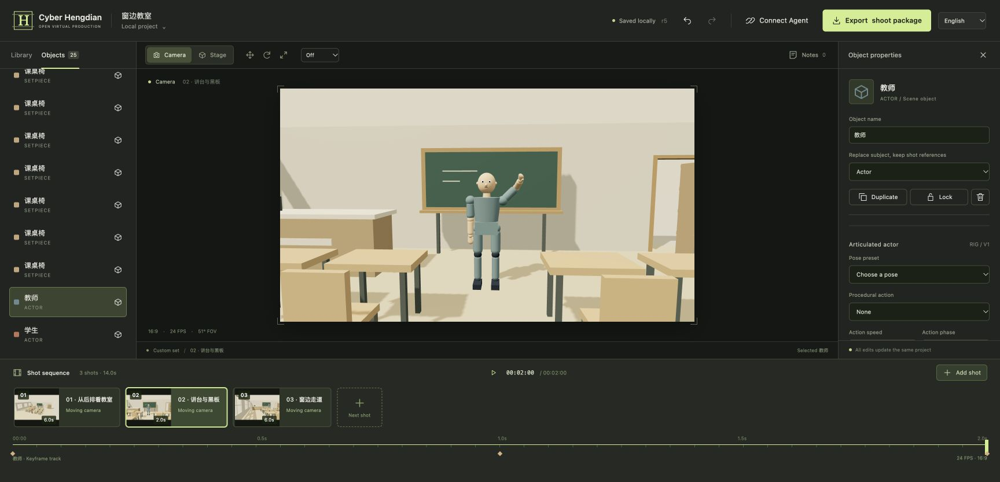
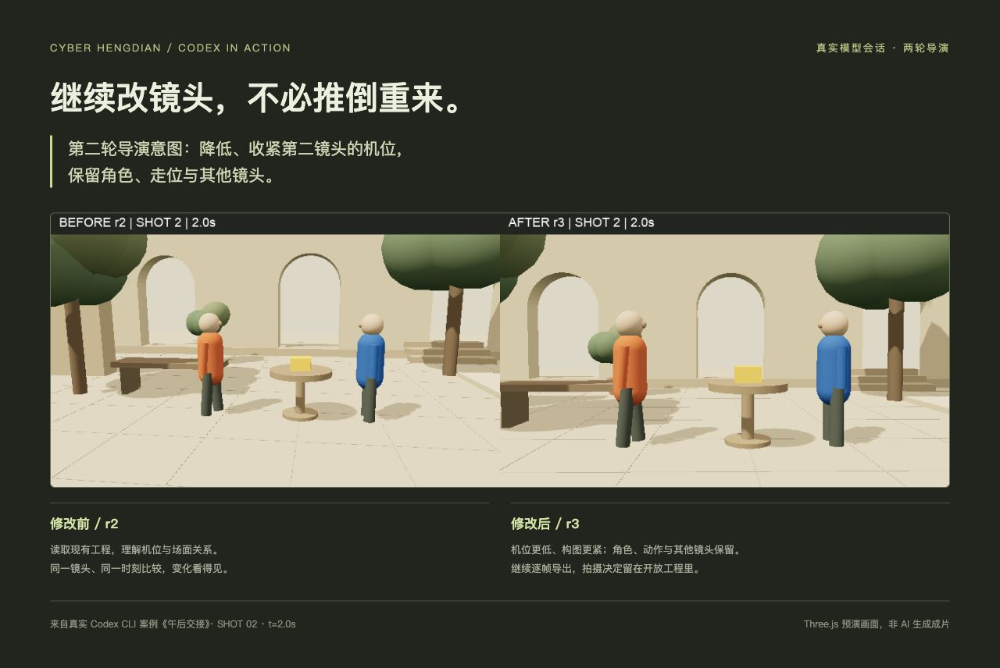
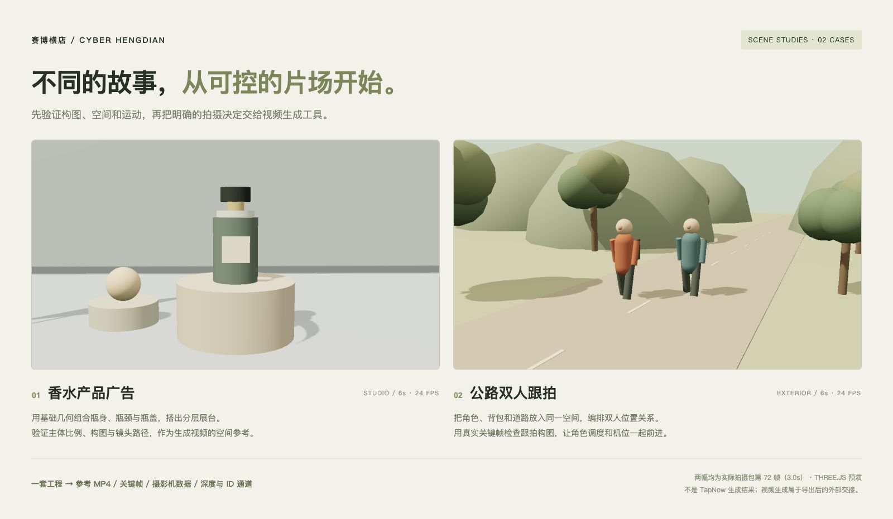

<!-- bip:project:start -->
# 赛博横店 · Cyber Hengdian

[简体中文](README.md) · [English](README.en.md)

**搭一次片场，让不同的人和 AI 接着拍。**

面向创作者与 AI Agent 的开源虚拟片场基础设施。场景、演员、动作和镜头保存在开放工程中；网页导演台、CLI 和 MCP 修改同一份作品。

当前是本地可运行的 0.1 基础版本。生成结果依赖后续选择的视频工具；本项目不把三维预演称为 AI 成片。



## 开始拍摄

需要 Node.js 22.12+。导出与 Agent 图片预览需要 Chromium / Chrome；视频导出还需要 FFmpeg。

```sh
npm install
npm run dev
```

打开 http://127.0.0.1:4317 。选择片场，布置对象，安排镜头与关键帧，播放检查，再导出拍摄包。

macOS 默认使用已安装的 Google Chrome。其他环境可运行 `npx playwright install chromium`，或通过 `CHROME_PATH` 指定浏览器路径；`FFMPEG_PATH` 可指定 FFmpeg 可执行文件。环境变量只影响当前进程，不修改系统配置。

```sh
npm run build
npm start
```

生产模式仍是本地服务；未配置公开托管或多人云协作。`PORT` 更改端口，`HENGDIAN_DATA` 更改工作空间目录。默认数据在被 Git 忽略的 `.hengdian/`，不要删除它来升级代码。

## 当前能力

- 原有三个程序化片场，新增乡村道路、都市街道、教室、医院、巴黎广场五套可编辑场景；30 个原创模型、4 个组合、自包含 GLB 导入、九个镜头配方。
- 17 组人物关节、8 种姿势预设、行走/奔跑/招手/说话/待机动作；按镜头保存姿态关键帧。新旧人物工程兼容。
- 中英双语界面、资源搜索与分类、位移吸附；保留用户自己写的工程名、镜头名与备注。
- 自由布置与摄影机视角，完整姿态编辑、稳定对象跟拍、镜头独立关键帧、时间批注。
- 版本化原子操作、撤销/重做、落盘恢复、过期编辑冲突拒绝。
- 可安装的外部数据片场包，版本不可覆盖；模型以内容哈希引用。
- 拍摄包包含可编辑工程、引用模型、参考 MP4、关键帧、逐帧摄影机数据、校验清单；可选深度与对象 ID 序列。
- CLI 与 stdio MCP 连接同一服务；配套 Skill 组织读取、导演、预览、检查与导出。



新增资产的单位、枢轴、许可和扩展约定见 [资产库](docs/ASSET-LIBRARY.md)。先选完整场景，再改演员、道具和镜头；场景替换需要确认，也可撤销。人物姿态轨道优先于程序动作，走位单独由位置关键帧控制。

## 给 Agent 使用

先启动服务，再从另一终端运行：

```sh
npm run cli -- --help
npm run cli -- status
npm run mcp
```

MCP 命令使用 stdio，适合由 Agent 宿主启动，不会显示网页。接入配置见 [Agent 指南](docs/AGENTS.md)，工作流程见 [导演 Skill](.agents/skills/direct-hengdian/SKILL.md)。已有登录的 Codex CLI 可运行 `npm run codex:direct -- examples/codex-courtyard/01-stage.md`；这会调用真实模型并修改当前片场，实验请使用独立工作空间。两轮自然语言导演案例、运行方法和实测边界见 [Codex 接入](docs/CODEX.md)。DeepSeek Harness 仍须独立实测。新增 [教室关节导演案例](examples/actor-classroom/README.md) 已由真实 Codex 建场、设置姿态轨道、查看三帧，并独立完成 720p 拍摄包导出与恢复。



## 从典型场景开始



| 想拍什么 | 在导演台先确定什么 | 可复用案例 |
| --- | --- | --- |
| 庭院会面 · 10 秒三镜头 | 两人站位、来客走位、景别与剪辑节奏 | [真实 Codex 自然语言导演](docs/CODEX.md) |
| 香水广告 · 6 秒单镜头 | 产品与展台关系、画面占比、侧移推进 | [打开场景工程](examples/showcase/product.hengdian.json) |
| 公路电影 · 6 秒单镜头 | 双人间距、前进方向、同速后退跟拍 | [打开场景工程](examples/showcase/road.hengdian.json) |

两个新场景是人工编排、可继续编辑的真实预演工程，均已完成 720p 视频及逐帧控制通道导出。导入方法、视频生成提示词和逐项验收点见 [场景指南](examples/showcase/README.md)。

导出 `motion.mp4` 后，可将它交给支持视频参考的生成工具；由生成模型完成外观与材质转译。摄影机数据、深度和 ID 是否能参与控制，取决于下游工作流。本项目当前没有内置 TapNow 自动直连。真实交接限制与结果见 [TapNow 实测记录](docs/showcase/TAPNOW.md)。

## 真实视频生成测试


用同一套预演分别测试 TapNow / Seedance 2.5 视频参考模式。香水和公路各完成一次 720p、约 6 秒的生成，并下载原视频核验；庭院旧版 360p 输入被拒绝，已重导原生 720p 输入，本轮未自动重试。

香水案例保留了产品、两个展台与球体的关系，转译出玻璃和石材质感，但推进幅度偏大，末帧展台下沿被裁切。公路案例保留了双人和服装关系，但人物仍是木偶，步态机械，**未达到真人自然行走目标**。完整记录与交接限制见 [TapNow 实测](docs/showcase/TAPNOW.md)，生成完成不代表每项导演意图都已满足。

## 建设自己的片场

本轮市场调研与取舍见 [导演台研究](docs/research/DIRECTOR-LANDSCAPE.md)，后续 IK、接触约束、镜头路径、动作重定向与社区资源注册表分层见 [扩展规划](specs/DIRECTOR-EXPANSION.md)。

从 [桌面产品示例](examples/tabletop.pack.json) 开始。资源包可以组合模型、对象与镜头，不需要修改运行核心。工程与包格式见 [格式说明](docs/FORMAT.md)，贡献方式见 [CONTRIBUTING](CONTRIBUTING.md)。

## 架构

- `src/core/`：开放数据、操作、插值与验证。
- `src/runtime/`：Three.js 场景与按时间渲染。
- `src/ui/`：导演工作台。
- `server/`：持久化、共享操作服务、资源与导出。
- `tools/`：CLI / MCP 客户端。
- `examples/`：可复用片场包。

设计推导见 [目标规格](specs/VISION.md) 和 [架构与交互](specs/ARCHITECTURE.md)。

## 验证

```sh
npm run check
npm run test:e2e
```

本轮检查与画面证据见 [扩展验证记录](docs/showcase/EXPANSION-VERIFICATION.md)。核心、真实 HTTP 和 MCP 协议测试使用独立临时工作空间。浏览器验证独立运行，不修改当前拍摄工程。模板检查同时保护原作者区和资产。

## 当前边界

首版为单个本地工作空间，不是公开多租户服务。场景与物体为预演精度；人物是 FK 关节编辑，尚无 IK、自动脚底锁定、手持约束；没有通用物理、任意骨骼重定向、完整剪辑或付费生成服务。程序行走默认原地循环，需要位置关键帧安排位移。GLB 保留原单位和枢轴、默认播放第一个动画；请在建模工具中整理模型。深度是线性 8-bit 参考，透明几何控制通道按不透明表面输出；完整控制通道最多 720 帧。镜头轨迹当前采用起止点线性插值。埃菲尔铁塔是约 6.45 米高的原创简化缩尺布景；内置模型依赖兼容运行时重建，拍摄包暂不包含它们的独立 GLB 文件。

<!-- bip:project:end -->

<!-- bip:creator:start -->
## 关于作者

你好，我是 **Cell 细胞**。我写代码，也写文章，把好奇心做成作品，探索更自主的工作与生活。

- [个人站 · cellinlab.com](https://cellinlab.com/)：作品、文章与联系入口。
- [造物矩阵](https://zaowujuzhen.com/about)：连接正在创造的人、作品与实践；公开创作记录、会员内容与交流是其中的一部分。
- [X · @cellinlab](https://x.com/cellinlab)：公开探索和开发进展。

扫码加我微信，备注 **GitHub** 就行。点击图片可查看原图。

<table>
  <tr>
    <td align="center" width="33%"><a href="public/wetouch/wechat.webp"></a><br>个人微信</td>
    <td align="center" width="33%"><a href="public/wetouch/wechat-channels.webp"></a><br>视频号</td>
    <td align="center" width="33%"><a href="public/wetouch/wechat-official.webp"></a><br>公众号 · Cell 细胞呀</td>
  </tr>
</table>

## 赞助

如果这些项目对你有帮助，也欢迎支持我的持续探索。

<table>
  <tr>
    <td align="center" width="50%"><br>支付宝</td>
    <td align="center" width="50%"><br>微信赞赏</td>
  </tr>
</table>
<!-- bip:creator:end -->

## License

[MIT](LICENSE)。使用模板请保留原许可证中的版权和许可声明。作者介绍、联系与赞助区是可配置内容，不是额外的授权条件。
