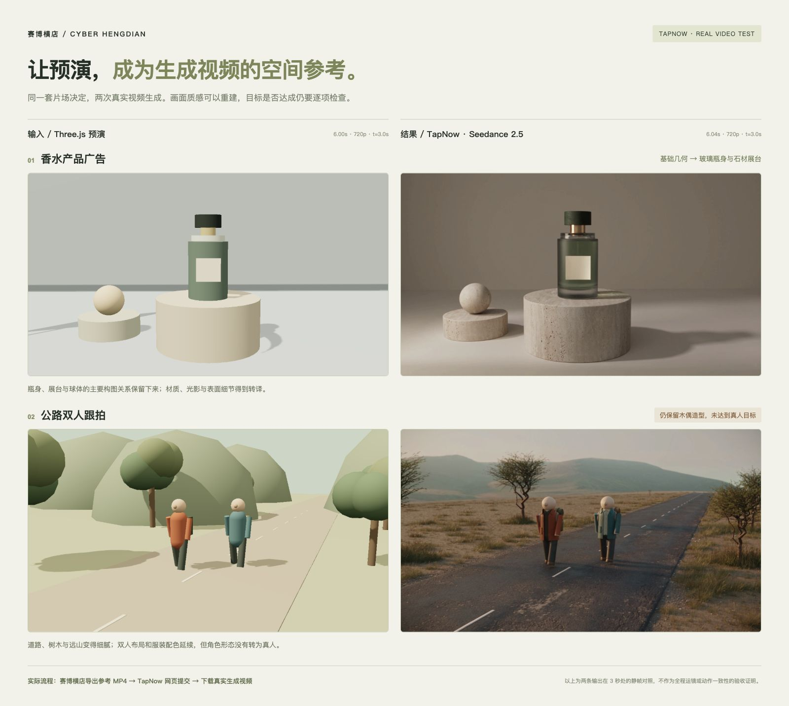

# TapNow 视频参考实测

日期：2026-10-13。测试目的不是比较生成模型，而是检查赛博横店导出的参考视频能否进入真实生成流程，以及空间关系、走位和摄影机运动保留到什么程度。

赛博横店负责开放工程、三维预演和拍摄包；TapNow 是本次使用的外部工具，通过浏览器手动上传参考。没有内置 API 直连，也没有将深度、ID 或摄影机 JSON 直接注入本次生成模型。

## 测试输入

| 案例     | 来源                        | 输入                   | 计划输出                                   |
| -------- | --------------------------- | ---------------------- | ------------------------------------------ |
| 庭院会面 | 真实 Codex 两轮自然语言导演 | 640×360，10 秒，三镜头 | Seedance 2.5 reference，720p，16:9，无音频 |
| 香水广告 | 人工编排的可复用预演工程    | 1280×720，6 秒，单镜头 | 同上，6 秒                                 |
| 公路跟拍 | 人工编排的可复用预演工程    | 1280×720，6 秒，单镜头 | 同上，6 秒                                 |

两个新场景的完整输入提示词和验收点见 [场景指南](../../examples/showcase/README.md)。每个案例仅提交一次，不自动重试。

## 实际结果

| 案例     | 交付状态                    | 已观察到的结果                                                       |
| -------- | --------------------------- | -------------------------------------------------------------------- |
| 庭院会面 | 请求失败，无成片            | 360p 输入不满足本次模式最低 480p 要求                                |
| 香水广告 | 一次生成完成，原 MP4 已下载 | 保留一瓶、两个展台和左侧球体，转译出玻璃、金属、石材与摄影棚光影     |
| 公路跟拍 | 一次生成完成，原 MP4 已下载 | 保留双人和服装左右关系，环境转译更丰富；人物仍为木偶，未达到真人目标 |

两条完成视频均为 **1280×720、24fps、145 帧、6.041667 秒、H.264，无音轨**。输入为 144 帧，输出多一帧；不能假设下游模型与预演逐帧对齐。文件已保存并计算 SHA-256。原视频与详细运行证据保留在本机被忽略的工作目录，不随仓库提交；精选真实帧用于下方展示。

## 已确认的交接限制

庭院案例在生成请求提交后失败：平台返回 `invalid_parameters`，可见错误为“参考视频分辨率过低，请上传分辨率更高的视频后重试。（≥ 480p）”。没有产生成片。前序 Agent 对附件可用性的文字确认没有发现这个门槛，因此不能替代生成服务的实际验证。

**给这个工作流导出参考视频时，选择 1280×720。** 640×360 可用于本地快速检查，但在本次 Seedance 2.5 reference 测试中不符合输入要求。应从工程重新渲染高分辨率参考，不把低清画面放大冒充原生细节。这个限制只描述本次实测的模型与模式，不代表所有下游工具。

已从同一份 r3 工程重新导出原生 1280×720 的三镜头输入并完成本地校验（10 秒、24fps、240 帧、三包共 501 项文件）；原工程保持不变。按本轮每案例一次的约定，没有自动重试庭院生成。

## 完整视频复核

两条输入与两条输出均在本地浏览器完整播放至结束，无媒体错误；另检查了每半秒采样序列、原尺寸首尾和公路步态细节。

- **香水：部分达到目标。** 一瓶、两台、一球的数量和左右关系保持，瓶盖与标签没有明显跳变；单镜头连续，没有新增物体或切镜。侧移推进趋势保留，但生成结果的推进更强，末帧主展台下沿被裁切，输入末帧则完整留在画面内。瓶体仍完整。不能据此宣称精确复现摄影机路径与构图幅度。
- **公路：空间关系保留，真人目标未达到。** 两人始终保留赭红在左、青色在右，领先关系、全身与脚部可见，背景有跟拍视差，没有换位、增减人物或切镜。角色保持圆球头与直杆四肢的木偶外观；有交替摆腿，但呈机械木偶步态并带拖滑观感，不是真人自然行走。

这次验证了参考视频的真实交接与可观察的空间延续，也暴露了外观参考和运动精度的局限。下一步值得验证的是将人物外观参考与空间运动参考分开提供；这属于后续实验方向，并非本轮已实现或已验证的能力。

## 参考理解也需要复核

准备香水与公路请求时，下游 Agent 曾把产品运镜描述为静止、把人物方向描述为背对摄影机。我们直接从真实 MP4 抽取首、中、尾画面，而非只检查导出的关键帧文件：产品左侧球体首尾约左移 54 像素，主展台画面宽度约从 359 增至 384 像素；公路人物三个时刻均能看到鼻子，背包在躯干后方，背景存在视差。源工程的摄影机与对象轨迹也与这些画面一致，因此保留原先的侧移推进与正面跟拍目标。

这是本次下游 Agent 对简化画面的判断误差，不是已确认的渲染故障。克制运镜、无眼睛的简化人物会增加辨识歧义；制作参考时可增强朝向线索，同时保留视频与轨迹作为核对依据。

## 结果评价方法

同时保留输入预演、原始输出和代表帧。文件与时长检查通过，只说明媒体已交付；人物左右身份、物体数量、构图、运动方向、剪辑节奏与时间一致性需要另行观看确认。精选截图不能证明整条视频都遵循了预演。
